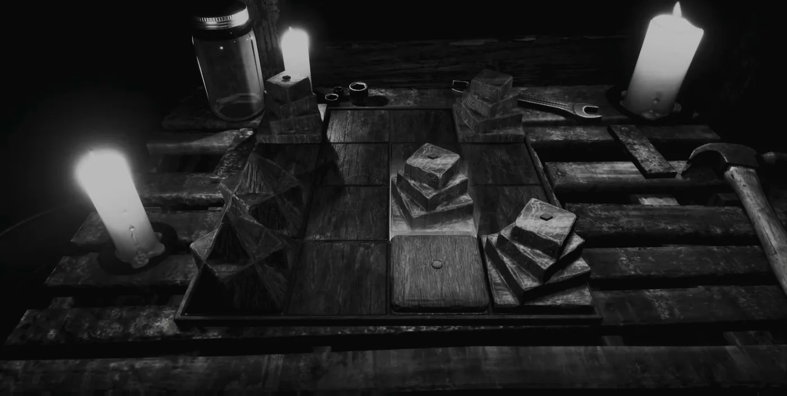
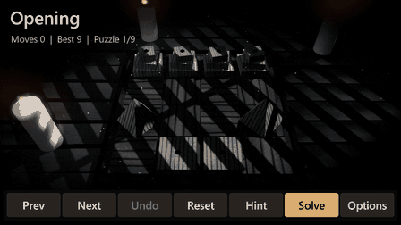
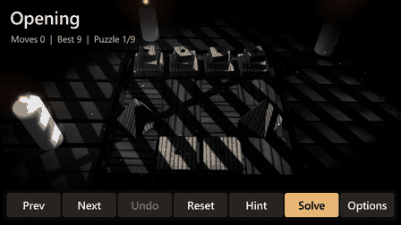

# GTA 6 minigame solver

A 3D recreation of GTA 6’s 4×4 sliding puzzle with a shortest-path solver written in C.

| Board reference | Playable board |
| --- | --- |
|  |  |

Extract the release archive. Run `tenebrae.exe` on Windows or `./tenebrae` on Linux. Click a piece, then a highlighted square to slide.

| Hint (`H`) | Auto-solve (`Space`) |
| --- | --- |
|  |  |

### Build on Linux

```sh
# Ubuntu or Debian
sudo apt install build-essential cmake libasound2-dev libx11-dev libxrandr-dev libxi-dev libgl1-mesa-dev libxcursor-dev libxinerama-dev
cmake -S . -B build -DCMAKE_BUILD_TYPE=Release
cmake --build build --parallel
./build/tenebrae
```

### Release

Once the project is on GitHub, push a version tag from the commit to release.

```sh
git tag v0.1.0
git push origin v0.1.0
```

GitHub Actions builds both x86-64 packages and attaches them to a draft in **Releases**. Open the draft and choose **Publish release**.
